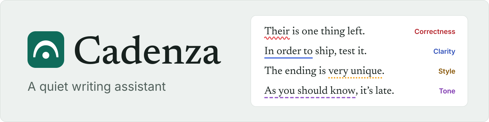

<h1>
  <picture>
    <source media="(prefers-color-scheme: dark)" srcset="docs/images/banner-dark.svg">
    
  </picture>
</h1>

Writing suggestions in any text field on the web. Cadenza underlines what it would change,
color-coded by kind (correctness, clarity, style, tone), using the AI provider you choose with
your own API key, or a model running on your own computer.

## Development

Requires Node 22.12+.

```bash
npm install
npm run dev          # builds the extension in watch mode
npm run check        # lint, typecheck, naming guard, unit tests
npm run test:e2e     # builds, then runs browser tests against the built extension
```

Load the extension: open `chrome://extensions`, turn on Developer mode, choose
**Load unpacked**, and select `packages/extension/.output/chrome-mv3` (run `npm run build`
first). A new install opens a setup page to connect a provider or a model on this computer;
test builds (`CADENZA_E2E=1`) start on built-in test rules instead.

To run the engine against a local OpenAI-compatible server:

```bash
CADENZA_LIVE_BASE_URL=http://127.0.0.1:11434/v1 CADENZA_LIVE_MODEL=<model> npx vitest run live
```

Project plan: [docs/PLAN.md](docs/PLAN.md). Spike findings: [docs/spikes.md](docs/spikes.md).
